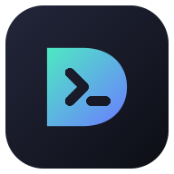

<p align="center">
  
</p>
<h1 align="center">Dania</h1>
<p align="center">基于 Flutter、Forui 和 Riverpod 的 Android 设备工具箱</p>

Dania 通过 Shizuku 管理本机，通过无线 ADB 连接其他 Android 设备，提供交互式终端、应用管理、文件管理和投屏。应用需要 Android 8.0（API 26）或更高版本，暂不支持 USB OTG。

## 快速开始

### 管理本机：Shizuku

1. 在运行 Dania 的设备上安装并启动 Shizuku。
2. 打开 Dania，在「设备」页选择「连接本机」，并在提示时授予 Shizuku 权限。

### 连接其他设备：无线 ADB

1. 在目标设备的开发者选项中开启「无线调试」，确保两台设备在同一局域网且端口可达。
2. 在 Dania 的「设备」页填写目标设备的 IP 地址和无线调试页面显示的**连接端口**。
3. 首次连接时，在目标设备上选择「使用配对码配对设备」。在 Dania 中开启「使用配对码」，填写弹窗显示的**配对端口**及六位配对码，先点「配对」，再点「连接」。配对端口和连接端口不要混用。

无线 ADB 支持 TLS 和 TCP 连接。ADB 密钥使用 Android Keystore 加密保存。ADB Shell 权限不等于 root，部分系统路径和应用私有数据仍无法访问。

## 主要功能

| 功能 | 说明 |
| --- | --- |
| 设备管理 | 查看 Shizuku 状态、管理本机授权与无线 ADB 连接 |
| 交互式终端 | 支持 ADB / Shizuku PTY、持久 Shell、ANSI 输出、全屏终端程序、软键盘与辅助按键 |
| 应用管理 | 搜索、查看详情、启用或停用应用、授予或撤销权限、卸载应用及安装 APK |
| 文件管理 | 浏览目录、上传、下载、另存为、新建目录、重命名和删除 |
| 投屏 | 内置 scrcpy 5.0.1 server，无需在目标设备另装应用；支持 H.264 视频、触控，以及返回、主页、最近任务和音量按键 |
| 设置与诊断 | 支持中英文、主题、字号、实时日志和运行环境查看；日志可搜索、复制和导出 |

### 终端使用说明

- 从「工具」页打开终端并选择设备，即可启动持久 Shell。连续执行命令会保留工作目录和环境变量；支持 Tab 补全、用方向键浏览历史、Ctrl+C 中断前台任务、Ctrl+D，以及运行 `top` 等终端程序。旋转屏幕或弹出软键盘时，终端会更新行列数。
- 辅助栏提供 Esc、Tab、方向键、一次性 Ctrl 修饰键和 Enter。「断开」结束 Shell，「清空显示」仅清除本地显示。长按可选择并复制选区，未选择时可复制缓冲区。快捷命令和本次会话历史（最多 30 条）只插入文本，按 Enter 才执行；原始按键流不会被记录到历史。
- 同一时间只保留一个活动会话。切换设备或离开终端页会结束旧会话；切到系统后台时会话保留，但应用进程被杀后不会恢复。退出或断线后需手动重连，应用不会重放输入。启动超时为 30 秒，运行中没有固定超时。终端输入输出不写入应用日志。

## 开发与构建

- Flutter：使用 FVM 安装 [项目锁定版本](.fvmrc)（3.47.6）。
- Android：安装 Android SDK 36 和 JDK 17；运行或调试需要 Android 8.0 或更高版本的设备。

在仓库根目录执行：

```sh
fvm install
fvm flutter pub get
fvm flutter run
```

构建调试 APK：

```sh
fvm flutter build apk --debug
```

构建产物位于 `build/app/outputs/flutter-apk/app-debug.apk`。

### 检查与测试

```sh
fvm dart format lib test integration_test
fvm flutter analyze --no-fatal-infos
fvm flutter test
./android/gradlew -p android :app:testDebugUnitTest
```

若全新检出后没有 `android/gradlew`，先执行一次上面的调试构建，由 Flutter 生成 Gradle Wrapper。

### 终端真机集成测试

[终端集成测试](integration_test/terminal_integration_test.dart)需要在测试设备上启动 Shizuku 并授权 Dania。若同时测试 ADB，目标设备还需信任 Dania 的 ADB 密钥，并提供无线 ADB **连接端口**。将下列占位值换成实际值：

```sh
fvm flutter test integration_test/terminal_integration_test.dart -d DEVICE_ID \
  --dart-define=TERMINAL_ADB_HOST=HOST --dart-define=TERMINAL_ADB_PORT=PORT
```

测试覆盖 Shell 身份、目录保持、中文输入、ANSI、补全、历史、Ctrl+C、`top`、窗口尺寸、自然退出和重连。请使用专用测试设备：测试会安装测试入口，安装失败时 Flutter 可能尝试卸载后重装；测试结束后需重新安装正常入口的构建。

## 实现与维护

- **终端传输**：Shizuku 通过随应用打包的 JNI PTY 库，以 Shizuku 的 shell/root 身份启动系统 Shell；ADB 使用 Shell v2 PTY。PTY 不可用时会报错，不退回普通命令管道。其他工具仍使用单次命令接口。
- **终端缓冲**：最多保留 5,000 行输出，按 UTF-8 增量解码；输入队列上限为 256 KiB，单批上限为 16 KiB。原生输出采用 8 个确认额度限制在途数据。
- **scrcpy 升级**：协议客户端与[内置 server](android/app/src/main/assets/scrcpy-server-v5.0.1)固定为 5.0.1，升级时应同步更新。
- **日志显示**：设置页各标签独立滚动，窄屏可长按复制单条日志。日志视图隐藏堆栈帧，搜索、复制和导出仍保留完整日志。

### 字体与第三方许可

应用使用 [MiSans](assets/MiSans-Regular.ttf)，遵循《MiSans 字体知识产权许可协议》。在「设置 → 关于」可查看字体声明、协议链接和第三方开源许可。
